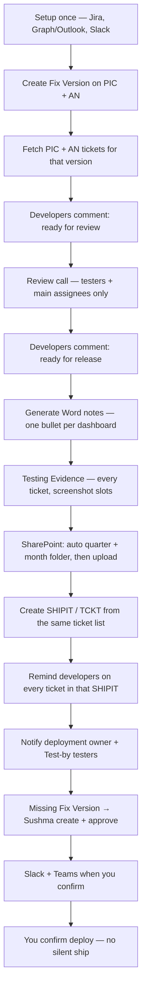

# Release Orchestrator

Release Orchestrator walks the weekly Insights release: tickets, two Jira comments (no group chase), Word notes (with Testing Evidence), SharePoint quarter/month folders, SHIPIT, Slack + Outlook to owner, testers, and Sushma, and safe deploy dates (no Friday). You confirm each live send.

Cursor MCP · PIC + AN together · dry_run until you confirm · Ignite can run the same tools

---

## Release lifecycle

---

## What it will do

- **One list, many outputs.** PIC and AN tickets grouped by dashboard. Notes, SHIPIT, Slack, and Testing Evidence share that list.
- **You stay in control.** Tools default to `dry_run=true`.
- **Ignite / any operator** use the same MCP. No extra group chats to run the release.
- **Review and release are comment-driven.** Developers do not post links, chats, Fix Version, or TCKT/SHIPIT status.
- **SHIPIT reminders** @mention the assignee on each included ticket.
- **Owners and testers** get Slack DM + Outlook from Test-by / deployment owner.
- **Review call** notifies testers + main assignees only (optional attendees skipped).
- **Empty Fix Version** goes to Sushma Bhamidipati: create the version if she can, then approve.
- **SharePoint** creates quarter (`2026 - Q4`) and month (`2026-10`) folders, then uploads the Word file.
- **Testing Evidence** lists every client and every ticket so post-prod testers can paste screenshots.

---

## Developer comments (this is the whole rule)

The release owner does **not** follow up in Slack or Teams groups. Review and release are decided from **Jira comments on the ticket**. The orchestrator fetches those comments — that is the gate.

On the ticket, post **one** of:

**ready for review**

**ready for release**

You do not need to post links, ping a group chat, set Fix Version, or update TCKT / SHIPIT status. Operators create the version and SHIPIT. Testers and owners are notified by the orchestrator. Jira status alone is not enough.

| When | Comment on the Jira ticket | What happens |
|------|---------|--------------|
| Ready for the review call | ready for review | Orchestrator reads the comment. Ticket can sit on the review list. |
| Ready for notes / SHIPIT | ready for release | Orchestrator reads the comment. Ticket can enter Word notes and the ship. |

After SHIPIT exists, `notify_shipit_developers` reminds each linked assignee on **that Jira ticket** (skips if already posted). Preview first (`dry_run=true`).

---

## Holidays and dates

Glofox and Ignite share the same company holidays from **Outlook / Teams** (cached in the background so MCP does not wait on every call). No daily quiz — one confirm per release run. Extra days off you name then are remembered. Friday and “day before a day off” still skip to the next safe deploy day; review uses the next workday if tomorrow is a holiday.

---

## Release notes — Testing Evidence

Generated from the selected tickets:

- **Clients** — only clients that have tickets; Analyze (Standard) only if AN tickets exist. Placeholder for deployment / configuration screenshots.
- **Tickets list** — every key with “Add testing screenshot(s) for this ticket.”

Regenerate notes when the ticket list changes. After prod, testers paste screenshots next to the matching client or ticket.

---

## SharePoint folders

From version date `2026.4.10.15` → October 2026:

`…/Release Notes/2026 - Q4/2026-10/Release Notes 2026.4.10.15.docx`

Missing folders are created on upload. Tokens: `{{year}}`, `{{quarter}}`, `{{month}}`.

---

## Notify tools

| Tool | Who | Channel |
|------|-----|---------|
| `notify_owners_and_testers` | Deployment owner + Test-by | Slack DM + Outlook |
| `notify_review_call` | Testers + main assignees | Slack DM + Outlook |
| `notify_missing_fix_versions` | Sushma Bhamidipati | Slack DM + Outlook |
| `notify_shipit_developers` | Assignee on each SHIPIT ticket | Jira comment |
| `create_fix_version` | — | Jira version on PIC/AN |
| `create_service_ticket` | — | SHIPIT/TCKT |

---

## Glofox vs Ignite — no clashes

MCP is bound to `RELEASE_PROGRAM` (default **glofox**). Packs live in `orchestrator/zones/knowledge/programs/`.

| Program | Trained | Projects | Crew |
|---------|---------|----------|------|
| Glofox | Yes | PIC + AN | This team's squad, QA, leaders |
| Ignite | No | PIC | Empty until trained — no Glofox copy |
| ETL | No | PIC | Empty |

Glofox review call: **leadership + QA + in-squad ticket owners**. Optional: Sai Anirudh (no Slack tester ping). Never: Gabriel, Erasmo. Developers still only comment **ready for review** / **ready for release**.

Train / inspect: `program_status`, `train_program(program="glofox")`. `switch_program("ignite")` is blocked until Ignite has its own roster.

---

## Setup — once

1. Open Cursor on this repo.
2. Type **Setup Release Orchestrator**.
3. Answer Jira, Graph/Outlook, Slack once. Do not paste passwords in chat.
4. Reload MCP.
5. Pick PIC + AN versions. Keep dry_run until the preview is right.

---

## If something fails

| What you see | What to do |
|--------------|------------|
| No tickets | Check version names (YYYY.Q.MM.DD) and Fix Version on tickets. |
| Same dashboard three times | Consolidate: one bullet, all keys in parentheses. |
| TCKT looks wrong | Keep rich text as formatted docs. |
| SharePoint failed | Playwright handoff or Graph credentials. No passwords in chat. |
| Mail/Slack did not send | Still on dry_run, or tokens not loaded. |
| Developer posted a PR link | Gate still only reads the Jira comment. Ask them to add **ready for review** or **ready for release** on the ticket. |
