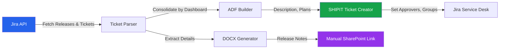

# Release Orchestrator


A configurable, multi-workspace automation platform for Jira release workflows **and the 6 PM Daily Review Agent** (PIC/AN ticket review, Teams meeting, calendar). Built for BI and engineering teams that manage multi-project releases, deployment tracking, and service desk change tickets through Jira Cloud.

## Overview

Release Orchestrator eliminates the repetitive manual work around Jira releases: reviewing tickets, generating release notes documents, creating change/deployment tickets, and posting deployment comments. Any team or organization can adopt it by editing a single `workspace.yaml` file — no code changes required.

**Built for:** Release managers, BI analysts, engineering leads, and anyone who deploys through Jira.

## Features

### Release Management
- [x] Multi-project release selection (e.g. PIC + AN in one flow)
- [x] Smart ticket grouping by client name or assignee
- [x] Cross-app release sharing — pick a release once, reuse everywhere
- [x] Ticket snapshot locking with drift detection

### Deployment Tracking
- [x] Paste-to-parse deployment info — auto-detects UUIDs, dates, times, client names
- [x] Deployment comment posting with ADF formatting
- [x] Automatic Done-transition with undo support
- [x] Duplicate comment detection (skip already-deployed tickets)
- [x] Full deployment history with search, filter, and CSV export

### Service Tickets
- [x] **SHIPIT** Manual Change ticket creation with all custom fields (legacy TCKT archived)
- [x] ADF description, implementation/test/backout plans, and business impact
- [x] Ticket consolidation by dashboard/report (with auto-dedup safety net)
- [x] **Auto-consolidation detector** — suggests merges by dashboard, client, and semantic similarity (v1.1)
- [x] Approver and approver group assignment
- [x] **Approver pre-flight validation** — checks accountIds + group names before create (v1.1)
- [x] Request type auto-set via Service Desk API with hardened error reporting (v1.1)
- [x] **Ticket Preview tab** — render draft exactly as it'll appear in Jira, with Copy-as-JSON / Copy-as-Markdown (v1.1)
- [x] **Diff Mode** — compare a draft against a previous SHIPIT field-by-field (v1.1)
- [x] **Test Plan Coverage Check** — warns when a dashboard is in the Description but missing from plans (v1.1)
- [x] **Confluence Release-Notes Companion** — optional publish-to-Confluence after creation (v1.1)
- [x] **SHIPIT History / Release Timeline** — searchable, exportable list of tickets you've reported (v1.1)
- [x] **Quick Stats sidebar** — totals, quarter/month counts, avg lead time, most-used approver (v1.1)

### Release Notes
- [x] Auto-generate Word (.docx) documents from Jira tickets
- [x] Jinja2 template engine with per-workspace overrides
- [x] Built-in DOCX generator with styled tables, fonts, and colors
- [x] In-app preview and download

### Workspace Management
- [x] Multi-workspace support — switch teams from the home page
- [x] In-app Settings page for full workspace configuration
- [x] Workspace import/export (YAML upload/download)
- [x] Configurable app visibility per workspace

### Metrics & Dashboards
- [x] DORA-style deployment dashboard (frequency, lead time, change volume, success rate)
- [x] Deployments by day-of-week and project breakdown
- [x] Recent deployments table with CSV export

### Daily Review Agent (v3.4 — merged)
- [x] **Same repo + MCP** — `daily_review_*` tools on `release-orchestrator` server
- [x] Guided E2E — `daily_review_orchestrator` or say **daily review welcome** in `release_orchestrator`
- [x] Playwright → Outlook web calendar (abcfitness.com profile)
- [x] Teams MCP for chat summary + failure alerts
- [x] Playwright MCP plugin for SharePoint + Slack browser fallback (release flow)
- [x] Setup: `.\scripts\setup_e2e.ps1` · Pilot: `.\scripts\daily_review\pilot_signoff.ps1`

### CI/CD
- [x] GitHub Actions CI with Ruff linting and pytest (includes Daily Review suite)
- [x] Docker and docker-compose for cloud deployment
- [x] Streamlit Community Cloud compatible

### v2.0 Tier-2 Capabilities

Version 2.0 adds a reusable shared library and five new project-level
modules that compose with the sibling `weekly-update-tool`:

- **Shared `common/` library** — `adf`, `atlassian`, `retry`, `notify`,
  `ai`, `cli` modules with injectable transports for 100% offline tests.
- **`template_library`** — reusable TCKT templates under
  `~/.jira-release-tool/templates/`, with `BUILTIN_TEMPLATES` for the most
  common deploy shapes. **Now wired to Platform (STK Step 4) and MCP
  (`list_tckt_templates`, `apply_tckt_template`, `save_tckt_template`)**.
- **`ai_enhancer`** — AI-generated release summary, risk rating and
  acceptance-criteria suggestions (falls back to deterministic heuristics
  when no LLM is configured). **Now wired to Platform (STK Step 5 review
  panel) and MCP (`ai_enhance_release`)**.
- **`linked_ticket_verifier`** — pre-flight validation of source tickets,
  with optional release-label application to passing issues. **Now wired
  to Platform (Ticket Review Step 2 expander) and MCP (`verify_linked_tickets`)**.
- **`confluence_publisher`** — Confluence wiki page generation from TCKT data.
  **Now wired to Platform (post-create section) and MCP (`confluence_publish_release_notes`)**.
- **`notifier`** — **legacy/deprecated** Slack + Teams *incoming webhook*
  announcements (`SLACK_DEPLOY_WEBHOOK`). Customize BI deployment announces
  use **`slack_announce`** + `SLACK_BOT_TOKEN` instead (Service Ticket UI and
  Release Orchestrator MCP). Do not confuse the two mechanisms.
- **`request_type_setter`** — hardened Service-Desk request-type setter
  with retry, jitter, audit log and transient/permanent error distinction.
- **`cli`** — `jira-release-tool` entry point with `create`,
  `validate-config` and `list-recent` subcommands, each supporting
  `--json` and `--dry-run`.

### v3.1 Guided MCP (final release surface)

- **`release_orchestrator`** — conversational E2E: welcome → yes through ticket review,
  exclusions, release notes, SharePoint, SHIPIT, Slack (opt-in), deploy, mark released.
- **Status + comment gates** — not Fix Version–based. Review fetch requires a **ready for review**
  Jira comment; release fetch requires **ready for release** (status alone is not enough).
- **GitHub PR gate** — on release-ready ticket fetch, open PRs block release; Jira comments
  @-mention assignees (`GITHUB_TOKEN` / `GH_TOKEN` in `.env`).
- **Slack announce** — download + folder SharePoint links; squad CC (Sushma, Sai, Zeke, Eoin);
  buddies CC (Sushma only). **Never auto-posts** — say **`send slack`** after SHIPIT.
- **Status-first fetch** — PIC Review + AN Passed QA with Glofox team default (Ignite/ETL override).
- **`say_to_user` / `user_can_say`** — agents show plain English; operators never memorize steps.
- **Skill:** `release-orchestrator-mcp` in Cursor skills.
- **Docs:** [docs/MCP_GUIDED.md](docs/MCP_GUIDED.md)

### v3.0 Platform + MCP Feature Additions

- **JQL Search Panel** — sidebar-accessible ad-hoc JQL search with CSV export.
- **MCP Workspace Config** — read workspace.yaml sections from MCP (`workspace_config`).
- **MCP TCKT History** — query user's TCKT tickets (`tckt_history`).
- **MCP Deployment Metrics** — DORA-style metrics from history (`deployment_metrics`).

```bash
jira-release-tool validate-config release.yaml
jira-release-tool create --config release.yaml --dry-run
jira-release-tool list-recent --limit 20 --json
```

### Release Orchestrator MCP (v3.1 — guided E2E)

The same project exposes a separate MCP process; the Streamlit UI is unchanged.

```powershell
.\.venv\Scripts\python.exe -m mcp_server
```

**Start here:** `release_orchestrator(message="welcome")` — conversational, full
platform parity. Say **welcome** → **yes** through each step; no need to remember
actions or confirmation tokens (auto-resolved on **yes**).

| Step | What happens |
|---|---|
| 1 | Fetch review-ready PIC + AN tickets (comment-gated; Glofox team default) |
| 2 | Lock selection + exclusions |
| 3 | Release notes DOCX (release-ready + comment-gated; GitHub PR check) |
| 4 | SharePoint link (Playwright upload or manual paste) |
| 5 | SHIPIT service ticket |
| 6 | Slack preview — **`send slack`** to post (never auto-posted) |
| 7 | Deploy comments + Done transitions |
| 8 | Mark released (optional) |

One-time `.env`: `JIRA_*` required; optional `DEFAULT_JIRA_TEAM`, `DEFAULT_PROJECTS=PIC,AN`, `DEFAULT_SELECTION_MODE=status`.

See **[docs/MCP_GUIDED.md](docs/MCP_GUIDED.md)** and Cursor skill `release-orchestrator-mcp`.

Advanced: `release_wizard` for low-level `start` / `update` / `confirm` / `resume`.

**Release-critical parity:** Platform UI and MCP share `release_critical.py`,
`recovery_contract.py`, and the same wizard processors. CI runs parity tests.

| Tool | Purpose |
|---|---|
| **`release_orchestrator`** | **Guided E2E — primary entry (welcome → yes)** |
| `release_wizard` | Low-level durable workflow with explicit actions |
| `release_workflow_checkpoints` | Ticket review / RN / SharePoint / SHIPIT / deploy flags |
| `validate_service_ticket` | SHIPIT blockers + warnings before create |
| `release_recovery_status` | Platform draft vs MCP session recovery |
| `fetch_release_tickets` | Status or fix-version fetch with team filter |
| `generate_release_notes_docx` | Standalone DOCX generation |
| `create_service_ticket` | Standalone SHIPIT create |
| `ai_enhance_release` | AI summary, risk, acceptance criteria |
| `workspace_config` / `tckt_history` / `deployment_metrics` | Config and observability |

## Architecture



## Tech Stack

| Component | Technology |
|---|---|
| Frontend | [Streamlit](https://streamlit.io/) (Python) |
| API Client | `requests` with retry/backoff and rate-limit handling |
| Document Format | Atlassian Document Format (ADF) builder |
| Doc Generation | `python-docx` for Word release notes |
| Templating | Jinja2 with filesystem loader and workspace overrides |
| Configuration | YAML (`workspace.yaml`) + `.env` for credentials |
| Testing | pytest (1,630+ offline tests) |
| Linting | Ruff |
| Containerization | Docker + docker-compose |
| CI | GitHub Actions |

## Installation

### From PyPI (recommended, once published)

```bash
pip install jira-release-tool
```

### From source

```bash
git clone https://github.com/abcfitness-insights/jira-release-tool.git
cd jira-release-tool
pip install -e ".[dev]"
```

## Getting Started

| I want to… | Start here |
|------------|------------|
| **Run a weekly PIC+AN release (MCP chat)** | **[docs/OPERATOR_GUIDE.md](docs/OPERATOR_GUIDE.md)** — start with **`week release`** |
| **Fast install (MCP only, ~10 min)** | **[docs/MCP_ONLY_SETUP.md](docs/MCP_ONLY_SETUP.md)** |
| **Full clone + Daily Review** | **[docs/COMPLETE_ONBOARDING.md](docs/COMPLETE_ONBOARDING.md)** — **`welcome onboard`** |
| **vs Deployment Bot** | **[docs/COMPARISON.md](docs/COMPARISON.md)** |
| **Can we release today?** | **[docs/RELEASE_READINESS.md](docs/RELEASE_READINESS.md)** — blocking vs non-blocking checks |
| **Streamlit UI** | **[docs/SETUP.md](docs/SETUP.md)** |
| **Incidents / undo** | **[docs/RUNBOOK.md](docs/RUNBOOK.md)** |
| **What each folder / `.py` file does** | **[REPO_LAYOUT.md](REPO_LAYOUT.md)** — operator vs optional code |

Full doc index: **[docs/README.md](docs/README.md)** (Operator vs Advanced).

### Operator phrases (E2E)

| Say | Does |
|-----|------|
| `fetch review tickets` | Review-ready fetch + lock (needs **ready for review** comment) |
| `fetch release tickets` | Release-ready list + GitHub PR check (needs **ready for release** comment) |
| `schedule review call` | Teams review-call calendar |
| `create release notes` | DOCX + SharePoint upload handoff |
| `create shipit` | SHIPIT change ticket |
| `send slack` | Post to both channels (download + folder links; explicit only) |
| `skip slack` | Continue without posting |

Source: **`orchestrator/server/phrase_catalog.py`** · verify: `pytest tests/test_guided_phrase_e2e.py -q`

### Prerequisites

- Python 3.10+
- A Jira Cloud instance with API access
- An [Atlassian API token](https://id.atlassian.com/manage-profile/security/api-tokens)

### Installation

```bash
git clone <repo-url> jira-release-tool
cd jira-release-tool
```

**Windows (automated):**

```bash
setup.bat
```

**Manual (any OS):**

```bash
python -m venv .venv
# Windows
.venv\Scripts\activate
# macOS / Linux
source .venv/bin/activate

pip install -e ".[dev]"
```

### Configuration

1. Copy the example environment file and add your Jira credentials:

```bash
cp .env.example .env
```

```ini
JIRA_BASE_URL=https://yourorg.atlassian.net
JIRA_EMAIL=you@company.com
JIRA_API_TOKEN=your-api-token-here
```

2. Edit `workspace.yaml` to configure your projects, apps, and team details — or use the in-app **Settings** page after launch.

#### Team ticket scope (required)

When multiple teams share the same fix-version naming pattern inside one Jira
project, **fixVersion alone is not a safe team boundary**. Each managed project
in `workspace.yaml` must define a `scope` block before ticket fetching works:

```yaml
projects:
  - key: PIC
    scope:
      board_id: "12345"          # or board URL — resolves to saved filter
      filter_id: ""              # optional saved-filter id (filter = …)
      labels_any: []             # optional OR list
      components_any: []
      jql: ""                    # extra AND clause only (no ORDER BY)
      allow_project_wide: false  # explicit escape hatch
      owns_version: false        # required for mark-released
```

Effective JQL is always:

`project = <key> AND fixVersion = <id> AND (<team scope>)`

Configure scope in **Settings → Projects**, use **Test team scope**, or call MCP
`team_scope_status`. Workflows fail closed until every managed project is scoped.

#### Release gates (Glofox defaults)

`workspace.yaml` → `release_gates` and `ticket_review` / `release_notes`:

| Gate | When | Behavior |
|------|------|----------|
| **Ready for review comment** | Ticket Review / review fetch | Every ticket needs a **ready for review** Jira comment |
| **Ready for release comment** | Release list / release notes | Every ticket needs a **ready for release** Jira comment |
| **GitHub PR** | Release-ready fetch | Open PRs → Jira comment @ assignee (`release_gates.github_pr`) |
| **Pre-review** (optional) | Ticket Review step 2 | Filter by Jira status; Slack notify assignees |
| **Post-QA** (optional) | Release Notes | Exclude non-QA-passed tickets from DOCX |

Slack deployment announce: `slack_announce.never_post_unless_asked: true` — preview until **`send slack`**.

MCP tools: `pre_review_gate`, `post_qa_gate`, `github_pr_gate_check`, `release_gate_status`.

### External integrations to finish later

Release Orchestrator ships the UI, dry-run previews, and shared MCP backends
before external credentials are added. An operator must complete these once:

1. **Slack bot:** create/invite the bot to `#insights-customize-squad` and
   `#customize-bi-buddies`, then set `SLACK_BOT_TOKEN` in `.env`. Channel IDs
   are already configured in `workspace.yaml`.
2. **Microsoft Graph app:** set `MS_GRAPH_TENANT_ID`,
   `MS_GRAPH_CLIENT_ID`, and `MS_GRAPH_CLIENT_SECRET`; grant application
   permissions `Sites.ReadWrite.All` (or `Files.ReadWrite.All`) and
   `Calendars.ReadWrite`, then grant admin consent.
3. **SharePoint target:** set `sharepoint_upload.enabled: true` and configure
   `drive_id`, or `hostname` + `site_path`, plus `folder_path`.
4. **Teams organizer:** set `teams_schedule.enabled: true`, `organizer_upn`,
   and default attendees.
5. Run one live SharePoint upload, Teams meeting, Slack send, and Deployer
   **Fill from Release Notes / SharePoint / History** smoke test.

### Running

```bash
streamlit run app.py
```

Then open [http://localhost:8501](http://localhost:8501).

**Desktop launchers (Windows):**

| Launcher | Description |
|---|---|
| `launcher.pyw` | Native desktop window via pywebview |
| `launch.vbs` | Silent browser launch |

### Docker

```bash
docker-compose up -d
```

Then open [http://localhost:8501](http://localhost:8501).

The compose file mounts `.env`, `workspace.yaml`, `workspaces/`, and `templates/` as volumes so configuration persists outside the container.

### Streamlit Community Cloud

1. Push to GitHub
2. Connect at [share.streamlit.io](https://share.streamlit.io)
3. Add secrets in the Streamlit Cloud dashboard (use the same keys as `.env`)

## Project Structure

```
jira-toolkit/
├── app.py                          # Main Streamlit entrypoint and router
├── config.py                       # YAML config loader with workspace support
├── jira_client.py                  # Jira REST API client (retry, backoff, rate-limit)
├── adf_builder.py                  # Atlassian Document Format helper functions
├── template_engine.py              # Jinja2 template loader with overrides
├── workspace.yaml                  # Team configuration (projects, apps, service desk)
├── requirements.txt                # Runtime dependencies (legacy convenience file)
├── pyproject.toml                  # Ruff, pytest, and coverage configuration
├── Dockerfile                      # Production container image
├── docker-compose.yaml             # One-command deployment
├── setup.bat                       # Windows bootstrap script
│
├── ui/                             # All Streamlit UI modules
│   ├── app_registry.py             # App discovery and metadata
│   ├── css.py                      # Global styles, stepper bar, CSS constants
│   ├── helpers.py                  # Session state, history I/O, env management
│   ├── home.py                     # Home page with team cards and app grid
│   ├── sidebar.py                  # Sidebar navigation
│   ├── settings.py                 # Admin settings UI (all workspace config)
│   ├── history.py                  # Deployment history list and detail views
│   ├── deployment_dashboard.py     # DORA-style deployment metrics
│   ├── step1_release.py            # Release Deployer: select release
│   ├── step2_tickets.py            # Release Deployer: ticket overview
│   ├── step3_exclude_fix.py        # Release Deployer: remove fix version from excluded tickets
│   ├── step3_deploy_info.py        # Release Deployer: paste deployment info
│   ├── step4_review.py             # Release Deployer: review and confirm
│   ├── step5_execute.py            # Release Deployer: execute and results
│   ├── ticket_review/              # Ticket Review app (3 steps)
│   ├── release_notes/              # Release Notes app (4 steps)
│   └── service_ticket/             # Service Ticket app (5 steps)
│
├── generators/
│   └── release_notes_generator.py  # Built-in DOCX generator (python-docx)
│
├── templates/
│   └── default/                    # Built-in Jinja2 templates
│       ├── deployment_comment.j2
│       ├── review_format.j2
│       ├── implementation_plan.j2
│       ├── test_plan.j2
│       ├── backout_plan.j2
│       ├── business_impact.j2
│       └── service_ticket_summary.j2
│
├── workspaces/                     # Additional team workspace configs
│   └── <team>/workspace.yaml
│
├── examples/                       # Example workspace configurations
│   ├── devops-team.yaml
│   └── software-dev-team.yaml
│
├── tests/                          # pytest test suite (1,630+ tests)
│   ├── test_adf_builder.py
│   ├── test_config.py
│   ├── test_error_handling.py
│   ├── test_jira_helpers.py
│   ├── test_parser.py
│   ├── test_template_engine.py
│   ├── test_workspace_config.py
│   └── test_integration_*.py
│
├── .github/workflows/ci.yml       # GitHub Actions CI pipeline
├── .streamlit/config.toml          # Streamlit server/theme configuration
└── .pre-commit-config.yaml         # Pre-commit hooks (Ruff)
```

## Environment Variables

| Variable | Required | Description |
|---|---|---|
| `JIRA_BASE_URL` | Yes | Jira Cloud instance URL (e.g. `https://yourorg.atlassian.net`) |
| `JIRA_EMAIL` | Yes | Email address for Jira API authentication |
| `JIRA_API_TOKEN` | Yes | API token from [Atlassian account settings](https://id.atlassian.com/manage-profile/security/api-tokens) |
| `GITHUB_TOKEN` or `GH_TOKEN` | No | GitHub PR merge check on release-ready fetch (recommended for Glofox) |
| `SLACK_BOT_TOKEN` | No | Optional; Cursor Slack MCP or Playwright works without it for announce |
| `JIRA_TOOLKIT_WORKSPACE` | No | Active workspace folder name from `workspaces/` (empty = root) |
| `STREAMLIT_SERVER_MAX_UPLOAD_SIZE` | No | Max upload size in MB (default: 10, used in Docker) |

## Workspace Configuration

All team-specific behavior is driven by `workspace.yaml`:

| Section | Purpose |
|---|---|
| `workspace.name` | Team display name (shown in UI and sidebar) |
| `workspace.jira.base_url` | Jira Cloud instance URL |
| `workspace.projects` | List of Jira projects to manage (`key`, `name`, `multi_client`) |
| `workspace.service_desk` | Service desk project, field IDs, and defaults |
| `workspace.deployment` | Environment name and transition settings |
| `workspace.release_notes` | Team metadata for release note documents |
| `workspace.apps` | Enable/disable and relabel individual apps |

See `examples/` for sample configurations for different team types.

## Custom Templates

Override any generated text by placing a Jinja2 template in the `templates/` directory. The engine checks `templates/` first, then falls back to `templates/default/`.

| Template | Used By |
|---|---|
| `deployment_comment.j2` | Release Deployer — deployment comment body |
| `review_format.j2` | Ticket Review — formatted review list |
| `implementation_plan.j2` | Service Ticket — implementation plan text |
| `test_plan.j2` | Service Ticket — test plan text |
| `backout_plan.j2` | Service Ticket — backout plan text |
| `business_impact.j2` | Service Ticket — business impact text |
| `service_ticket_summary.j2` | Service Ticket — ticket summary |

## Multi-Workspace

Run multiple team configurations from one installation:

```
workspaces/
  analytics-team/workspace.yaml
  devops-team/workspace.yaml
```

Switch between workspaces from the home page team cards or set `JIRA_TOOLKIT_WORKSPACE=analytics-team` in `.env`. The active workspace persists across restarts.

## API / Workflow Guide

### Typical Release Deployer Flow

1. **Select Release** — pick a project and unreleased version
2. **Review Tickets** — see all tickets with status validation warnings
3. **Exclude Tickets** — remove fix version from tickets not shipping with this release
4. **Paste Deployment Info** — paste CI/CD output; UUIDs, dates, times, and client names are auto-parsed
5. **Review & Confirm** — verify per-client deployment details and comment preview
6. **Deploy** — comments are posted, tickets transitioned to Done, with full undo support

### Jira API Integration

The `jira_client.py` module handles all Jira REST API communication:

- Automatic retry with exponential backoff on 429 (rate limit)
- POST-based search via `/search/jql` with `nextPageToken` pagination
- Auth credentials never logged (redacted in error handlers)
- Comment deduplication before posting

## Testing

```bash
python -m pytest tests/ -v
```

All 1,630+ tests run without network access — Jira, GitHub, and Slack calls are mocked.

## Contributing

See [CONTRIBUTING.md](CONTRIBUTING.md) for guidelines.

1. Fork the repository
2. Create a feature branch (`git checkout -b feature/my-feature`)
3. Run tests (`python -m pytest tests/ -v`)
4. Run lint (`ruff check .`)
5. Open a Pull Request

## License

[MIT](LICENSE) — Copyright (c) 2024-2026 ABC Fitness Solutions
