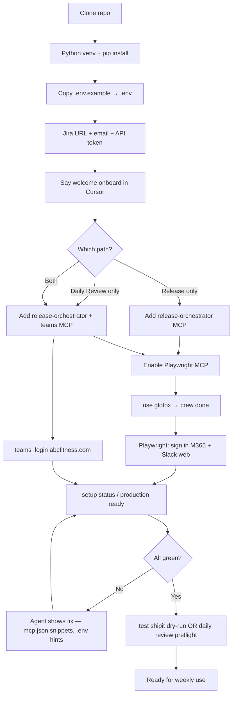
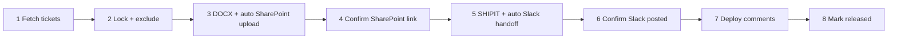

# Complete Onboarding — Release Orchestrator (Clone → Ready)

**Time:** ~15–20 minutes one-time per machine  
**Audience:** New colleagues after `git clone`  
**Agent skill:** `skills/release-orchestrator-onboarding/SKILL.md`

Say **`welcome onboard`** in Cursor chat — the agent walks you through verification. This doc is the human-readable map.

> **Can we release today?** See **[RELEASE_READINESS.md](./RELEASE_READINESS.md)** — what blocks vs what doesn't.

---

## What you are setting up

| Layer | What | Where |
|-------|------|--------|
| Python app | Release + Daily Review engine | This repo + `.venv` |
| Secrets | Jira API (your account) | Local `.env` only — never commit |
| MCP servers | Cursor talks to the app | `~/.cursor/mcp.json` |
| Browser auth | SharePoint, Slack, Outlook | One-time sign-in via Playwright |
| Teams auth | 6 PM summary chat | `teams_login` once |

---

## High-level flow



---

## MCP verification matrix

After clone, **every row must be checked** before the first live release.

| ID | Required | How to verify | If missing |
|----|----------|---------------|------------|
| **release-orchestrator** | Always | MCP tool `setup status` or `production_readiness` | Paste JSON from `daily_review_mcp_config` → reload Cursor |
| **playwright** | Glofox release + calendar | Navigate to Slack/Outlook in Playwright browser | Cursor → Settings → MCP → enable `playwright` |
| **teams** | Daily Review | `teams_login` succeeds | Add `teams` block from `daily_review_mcp_config`; `npm install` in teams-mcp |
| **slack** plugin | Optional | — | Skip for Glofox Step 6 (private channels) |
| **atlassian** plugin | Optional | — | Jira writes still need `.env` token |
| **Jira .env** | Always | `JIRA_BASE_URL`, `JIRA_EMAIL`, `JIRA_API_TOKEN` set | User creates token at [Atlassian API tokens](https://id.atlassian.com/manage-profile/security/api-tokens) |

**Important (Glofox Customize BI):** Step 6 Slack uses **Playwright**, not Slack MCP — private channels `#insights-customize-squad` and `#customize-bi-buddies` are not visible to the Slack plugin.

---

## Step-by-step checklist

### Phase 1 — Install (no accounts yet)

```powershell
cd path\to\jira-release-tool
.\scripts\setup_e2e.ps1
```

Or manually:

```powershell
python -m venv .venv
.venv\Scripts\pip install -r requirements.txt
copy .env.example .env
```

### Phase 2 — Jira credentials (you provide)

1. Open `.env` in the repo root.
2. Set:
   - `JIRA_BASE_URL=https://abcfinancial.atlassian.net`
   - `JIRA_EMAIL=you@abcfitness.com`
   - `JIRA_API_TOKEN=` *(paste from Atlassian — shown once)*

**Do not paste the token in Cursor chat.** Edit the file locally.

### Phase 3 — Cursor MCP config

1. In Cursor chat, ask the agent for **`daily_review_mcp_config`** (or say **`setup status`**).
2. Open `%USERPROFILE%\.cursor\mcp.json` (Windows) or `~/.cursor/mcp.json` (Mac/Linux).
3. Under `mcpServers`, add at minimum:

```json
{
  "mcpServers": {
    "release-orchestrator": {
      "command": "C:/path/to/jira-release-tool/.venv/Scripts/python.exe",
      "args": ["-m", "release_mcp"],
      "cwd": "C:/path/to/jira-release-tool",
      "env": {
        "TEAMS_MCP_ROOT": "C:/path/to/jira-release-tool/scripts/daily_review",
        "RELEASE_ORCHESTRATOR_ROOT": "C:/path/to/jira-release-tool"
      }
    }
  }
}
```

Replace paths with **your** clone location. Use forward slashes in JSON.

4. **Reload MCP** in Cursor (Settings → MCP → refresh, or restart Cursor).
5. Say **`mcp configured`**.

**Daily Review track:** also add the `teams` server block from the same config output.

**Playwright:** enable in Cursor MCP list (often pre-installed as `playwright` plugin).

### Phase 4 — Team + crew (shared template, your `.env`)

In Cursor chat:

```
use glofox
crew done
```

This writes `TEAM_CREW_*` lines to `.env` for review calls, QA, leadership, and exclusions.

### Phase 5 — One-time browser auth (you sign in)

| Service | When | Confirm with |
|---------|------|--------------|
| Microsoft 365 / Outlook | SharePoint upload, review-call calendar | **playwright confirmed** |
| Slack web | Step 6 announce (Glofox) | **playwright confirmed** |
| Microsoft Teams | Daily Review chat | **teams_login** → **teams done** |

The agent opens the browser via Playwright MCP — you complete MFA/login once per machine.

### Phase 6 — Verify ready

```
setup status
production ready
```

Optional first dry-run:

```
test shipit
fetch review tickets
```

For Daily Review:

```
daily review setup
daily review preflight
```

---

## Release workflow (after onboarding)



**Phrases:**

| Say | Meaning |
|-----|---------|
| `fetch review tickets` | Review-ready fetch + lock (Step 1) |
| `fetch release tickets` | List release-ready tickets only (no lock) |
| `schedule review call` | Teams review-call calendar invite |
| `create release notes` | DOCX + SharePoint |
| `create shipit` | SHIPIT + Slack |

Full release: `start` → `fetch review tickets` → `yes` … → `slack done` → `yes deploy`

**E2E verification:** `pytest tests/test_guided_phrase_e2e.py` (58 tests — phrase routing + auto-chains)

**Source of truth:** `release_mcp/phrase_catalog.py` · agent rule: `.cursor/rules/phrase-e2e-handling.mdc`

Full phrase list: say **`help`** in chat or see `skills/release-orchestrator/SKILL.md`.

---

## What is shared vs per-person

| Shared in repo | Per-person (never commit) |
|----------------|---------------------------|
| `workspace.yaml`, Slack channel IDs, templates | `.env` Jira token + email |
| `team_crew.yaml` / Glofox defaults | Playwright browser profile login |
| MCP JSON *structure* (paths differ per clone) | Teams login session |

---

## Troubleshooting

| Problem | Cause | Fix |
|---------|-------|-----|
| `Invalid JSON` in mcp validation | Syntax error in `mcp.json` | Fix JSON (trailing comma, duplicate keys); disable deprecated `daily-review-agent` |
| No tickets returned | Bad Jira token or wrong team | Re-check `.env`; say **use glofox** |
| Slack MCP `channel_not_found` | Private Glofox channels | Use **send slack** (Playwright path) |
| SharePoint upload fails | Not signed into M365 | Sign in via Playwright → **sharepoint done** |
| Teams message fails | Session expired | **teams_login** again |
| Gabriel/Erasmo tickets appear | Old config | Default skips outside-squad assignees — say **fetch review tickets** again |

More: [TROUBLESHOOTING.md](./TROUBLESHOOTING.md)

---

## Colleague pilot (share this repo)

1. Clone the repo and open it in **Cursor**.
2. In chat, say **`welcome onboard`** — the agent runs MCP verification and shows only what you must auth/configure.
3. Follow the checklist until **`production ready`** is green.
4. Dry-run once: **`test shipit`** → **`fetch review tickets`** → **`yes`** → **`create release notes`** → **`sharepoint done`** → **`create shipit`** → **`slack done`**.
5. Skill for agents: [`skills/release-orchestrator-onboarding/SKILL.md`](../skills/release-orchestrator-onboarding/SKILL.md).

Pilot owner: confirm one colleague completes steps 1–4 before team-wide rollout.

---

## Related docs

| Doc | Purpose |
|-----|---------|
| [SETUP.md](./SETUP.md) | Streamlit platform install |
| [MCP_GUIDED.md](./MCP_GUIDED.md) | Guided chat workflow |
| [skills/release-orchestrator/SKILL.md](../skills/release-orchestrator/SKILL.md) | Weekly release playbook |
| [skills/release-orchestrator-onboarding/SKILL.md](../skills/release-orchestrator-onboarding/SKILL.md) | Agent verification rules |

---

## Quick reference — chat phrases

| Phase | Say |
|-------|-----|
| Start onboarding | `welcome onboard` |
| Pick team | `use glofox` |
| Save crew | `crew done` |
| MCP added | `mcp configured` |
| Browser login done | `playwright confirmed` |
| Teams login done | `teams done` |
| Check readiness | `production ready` |
| Dry-run release | `test shipit` |
| Get help | `help` |
